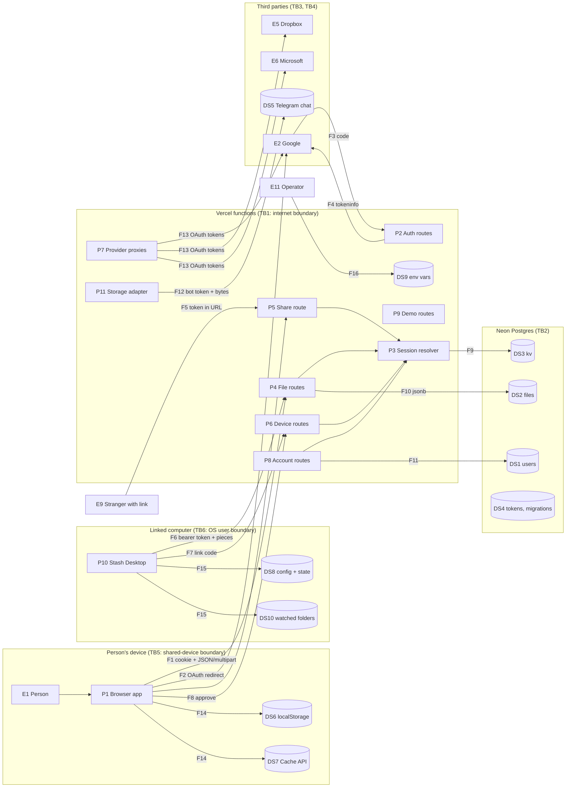

# Stash threat model: STRIDE per element

Method: the application is drawn as a data-flow diagram (DFD); every element is
listed and classified; the STRIDE categories that apply to each element type
are fixed by the method (Microsoft SDL threat modelling), so every element gets
the same questions:

| Element type | Spoofing | Tampering | Repudiation | Information disclosure | Denial of service | Elevation of privilege |
| --- | --- | --- | --- | --- | --- | --- |
| External entity | yes | | yes | | | |
| Process | yes | yes | yes | yes | yes | yes |
| Data store | | yes | yes | yes | yes | |
| Data flow | | yes | | yes | yes | |

Two reviewers with this diagram produce the same table of questions; the
answers (status and evidence) are checked against the code at `main` 808ccf4
on 2026-11-08. Where a row matches a finding in the earlier judgement pass
(docs/RISK-ASSESSMENT.md) its id is given. New findings are marked **new**.

Status words: **ok** (mitigated in code), **gap** (unmitigated), **partial**,
**accepted** (by design, documented), **n/a**.

## 1. Data-flow diagram

### Elements

| Id | Type | What | Code |
| --- | --- | --- | --- |
| E1 | entity | The person, in a browser | |
| E2 | entity | Google: OpenID sign-in, Drive API | `lib/google.ts`, `lib/auth.ts` |
| E5 | entity | Dropbox API | `lib/providers.ts` |
| E6 | entity | Microsoft Graph / Entra | `lib/providers.ts` |
| E9 | entity | Stranger holding a share link | `app/s/[token]`, `api/share/[token]` |
| E11 | entity | Operator (sets env vars, owns the bot, the Vercel and Neon accounts) | Vercel dashboard |
| P1 | process | Browser app: drive UI, client crypto, piece uploads, previews, export | `components/*`, `lib/crypto.ts`, `lib/upload.ts`, `lib/thumbs.ts`, `lib/export.ts` |
| P2 | process | Auth routes: sign-in start, OAuth callback (sign-in and Drive), provider callbacks, dev sign-in | `api/auth/google`, `api/google/callback`, `api/providers/[p]/callback`, `api/auth/dev` |
| P3 | process | Session resolver: cookie → kv session, or bearer → device | `lib/session.ts`, `lib/devices.ts` |
| P4 | process | File routes: list, upload (one piece or pieces), download, rename/move, delete, thumb, folders | `api/files/*`, `api/folders` |
| P5 | process | Share: make/remove link, public download with server-side decryption, public page | `api/files/[id]/share`, `api/share/[token]`, `app/s/[token]`, `lib/server-crypto.ts` |
| P6 | process | Device routes: link start/poll/approve, list, rename, unlink, status report | `api/devices/*`, `lib/devices.ts` |
| P7 | process | Provider proxies: list a drive, fetch one file's bytes | `api/google/files`, `api/google/file`, `api/providers/[p]/files`, `api/providers/[p]/file` |
| P8 | process | Account routes: me, protection mode, adoption, sign out | `api/me`, `api/account/protection`, `api/auth/adopt`, `api/auth/signout` |
| P9 | process | Demo routes: simulated migration and photo backup | `api/migrate`, `api/photos` |
| P10 | process | Stash Desktop agent (CLI and Electron app) | `desktop/lib/*`, `desktop/app/*` |
| P11 | process | Storage adapter: Telegram Bot API or local blobs | `lib/telegram.ts` |
| DS1 | store | `users` (email, name, picture, key or wrapped key, provider tokens, protection mode) | `lib/store-pg.ts` |
| DS2 | store | `files` (catalogue rows with storage pointers) | `lib/store-pg.ts` |
| DS3 | store | `kv` (sessions, devices, device tokens hashed, link codes, share tokens, Drive listing cache, folders, rate data) | `lib/store-pg.ts` |
| DS4 | store | `tokens`, `migrations` (legacy and demo) | `lib/store-pg.ts` |
| DS5 | store | Telegram chat holding every ciphertext object | `lib/telegram.ts` |
| DS6 | store | Browser localStorage: file key, remembered accounts, copy done-sets, view prefs | `lib/crypto.ts`, `lib/accounts.ts` |
| DS7 | store | Browser Cache API: ciphertext copies and encrypted previews | `lib/filecache.ts` |
| DS8 | store | `~/.stash/config.json` (device token, unwrapped key on Locked accounts), `state.json` | `desktop/lib/config.mjs` |
| DS9 | store | Vercel environment: bot token, Google secret, DB URL, provider secrets | Vercel |
| DS10 | store | The person's own folders on the linked computer | `desktop/lib/scan.mjs` |

Flows F1 to F16 are listed in section 4 with their boundaries.

Trust boundaries: TB1 internet ↔ Vercel; TB2 Vercel ↔ Neon; TB3 Vercel ↔ Telegram; TB4 Vercel ↔ Google, Dropbox, Microsoft; TB5 the browser's storage is reachable by anyone using the same device profile; TB6 the desktop app's files are readable by the same OS user.

## 2. External entities (S, R)

| Element | Category | Threat | Status | Evidence / note |
| --- | --- | --- | --- | --- |
| E1 Person | S | Someone else pretends to be the person | **partial** | Identity is Google sign-in (strong); but a session cookie never expires server-side and cannot be revoked from elsewhere (S-2). On a shared device the key sits in localStorage (TB5), so sign-out hygiene is the only protection. |
| E1 | R | Person denies an action (deleted, shared) | **gap** | No audit log (Rp-1). |
| E2 Google | S | A fake identity provider / forged id token | **ok** | `auth.ts identityFromIdToken` asks Google's tokeninfo endpoint and checks `aud`; OAuth state nonce in an httpOnly cookie. **new, minor:** the OpenID `nonce` claim is not sent and checked, only the OAuth `state`; adequate for code flow, belt-and-braces missing. |
| E2 | R | Google denies issuing a token | n/a | Not a business risk here. |
| E5 Dropbox / E6 Microsoft | S | Forged callback | **ok** | State cookie with nonce and uid, checked in `providers/[p]/callback`. |
| E5 / E6 | R | | n/a | |
| E9 Stranger | S | Guessing a share token | **ok** | 18 random bytes (`randomBytes(18)`), format-checked; no rate limit but 2^144 space. |
| E9 | R | Stranger denies downloading | **accepted** | No download log; links are deliberately anonymous. |
| E11 Operator | S | Someone with the Vercel or Neon login acts as the operator | **accepted** | Protect those accounts with 2FA (outside the code). |
| E11 | R | Operator denies a change to env or data | **gap** | No change log beyond Vercel's own; acceptable at one operator. |

## 3. Processes (S, T, R, I, D, E)

### P1 Browser app

| Cat | Threat | Status | Evidence |
| --- | --- | --- | --- |
| S | Another page impersonates the app to the person (phishing) | **accepted** | Out of scope; the Google consent screen names the app. |
| T | Script injected into the page (XSS) alters what the app does | **partial** | React escapes all rendered text; file names set with `textContent` in `showLoading`; no `dangerouslySetInnerHTML`. Gaps: a `blob:` SVG opened in a tab runs on the app origin (I-2, fix on disk uncommitted); no CSP until the uncommitted `next.config.ts` change (I-8). |
| R | The app cannot prove what the person did | **gap** | Rp-1. |
| I | Secrets visible in the bundle | **ok** | Only `NEXT_PUBLIC_STASH_STAGE` is public; grep confirms no other `process.env` in client code. |
| I | Key readable by other scripts or extensions | **accepted** | Key in localStorage is the chosen design for Standard; Locked keeps it there too after unlock. Documented in the privacy copy. |
| D | Huge file opened in a tab exhausts memory | **gap, low** | `decryptChunked` concatenates the whole file (D-5). |
| E | Client-side checks bypassed | **ok** | Every decision is re-made server-side (owner checks by `uid`, device restrictions). |

### P2 Auth routes

| Cat | Threat | Status | Evidence |
| --- | --- | --- | --- |
| S | Forged OAuth callback signs someone in as another | **ok** | nonce in state cookie; tokeninfo verification; `aud` check. |
| S | Dev sign-in reachable in production | **ok** | `STASH_DEV_SIGNIN` required and refused when `VERCEL` is set; verified 404 on production. |
| T | `next` redirect parameter sends the person to a hostile site | **ok** | `safeNext` allows only same-origin paths (`/` not `//`). |
| T | Callback state replayed | **ok** | State cookie is deleted on first use; 10-minute max age. |
| R | No record of sign-ins | **gap** | Rp-1; also no "new sign-in" notice (ASVS 2.2.3). |
| I | Error pages leak internals | **ok** | Callback failures redirect with `?error=denied|failed|expired`, no detail. |
| D | Flooding sign-in start creates state cookies / outbound requests | **gap** | No rate limit (D-3); cost is low (no DB write on start). |
| E | A device token used to sign in or change account settings | **ok** | `approve`, `protection` and `share` routes refuse `s.deviceId`. |

### P3 Session resolver

| Cat | Threat | Status | Evidence |
| --- | --- | --- | --- |
| S | Stolen cookie or device token reused | **partial** | Cookie: httpOnly, Secure in production, SameSite=Lax, random 3×newId; **no expiry on the server, no revocation list** (S-2). Device token: 32 random bytes, stored hashed, revocable. |
| T | Session record altered | **ok** | Only server code writes `sess:*`; kv is not reachable by clients. |
| R | | n/a | |
| I | Session id in URLs or logs | **ok** | Cookie only; no logging of ids (no `console.*` in routes). |
| D | Session lookup per request as a DoS vector | **accepted** | One keyed read per request. |
| E | A session for uid A resolving to uid B | **ok** | Lookup by opaque id; uid stored server-side only. |

### P4 File routes

| Cat | Threat | Status | Evidence |
| --- | --- | --- | --- |
| S | Acting on files without a session | **ok** | Every handler calls `getSession()` and returns 401. |
| T | **Registering pieces one did not upload** (storage pointers accepted from the client in `POST /api/files` JSON and `PUT /thumb`) | **gap, High** | T-1. The patch (server-issued upload ids, `lib/uploads.ts`) was drafted and withdrawn when you asked for the method instead; it is the first item to build. |
| T | Renaming into a path that escapes a folder tree | **ok** | Folder is a string label, never a filesystem path; names capped at 255. |
| T | Batch move of files one does not own | **ok** | `PATCH /api/files` looks each id up by `(uid, id)`. |
| R | Deletions untraceable | **gap** | Rp-1. |
| I | Listing another person's files (IDOR) | **ok** | All queries filter by session `uid`; ids are random. |
| I | Listing leaks storage pointers | **ok (since 808ccf4)** | `listFor` projects public fields in SQL. |
| D | Oversized request bodies | **ok** | One piece ≤ 4 MB (`ONE_PIECE_MAX`), pieces ≤ `CHUNK_CIPHER_BYTES`, thumb ≤ 512 KB; Vercel caps at 4.5 MB anyway. |
| D | Unbounded pieces per account; abandoned pieces never swept | **gap** | R-1, D-1. |
| D | Catalogue reads per request exhaust the metered database | **partial** | Fixed for listing and counts (808ccf4); the full listing is still returned on every `/api/files` (no paging). D-2. |
| E | Device token writing to another account | **ok** | `deviceForToken` yields the device's own uid. |

### P5 Share route and page

| Cat | Threat | Status | Evidence |
| --- | --- | --- | --- |
| S | | n/a | Public by design. |
| T | Served content executes on the app origin (stored XSS via inline HTML/SVG) | **gap, High** | I-1. Fix on disk (uncommitted): inline only for image (not SVG), video, audio, PDF; `nosniff`; `CSP: sandbox`. |
| R | | accepted | Anonymous downloads. |
| I | Owner's name shown on the page | **accepted** | Deliberate ("shared by"). |
| I | Token in Referer when the page loads third-party resources | **ok** | The page loads nothing third-party; `Referrer-Policy` arrives with the uncommitted headers. |
| I | Server-side decryption exposes the key | **accepted** | Standard accounts only; Locked accounts refuse (409). |
| D | Mass downloads through a link | **gap** | No rate limit (D-3); each download streams from Telegram through a function (cost: function time). |
| E | A link reaching a different file than intended | **ok** | `share:<token>` → `{uid, fileId}`, re-checked against `f.share.token`. |

### P6 Device routes

| Cat | Threat | Status | Evidence |
| --- | --- | --- | --- |
| S | Guessing a link code | **gap, Medium** | 32^6 codes, 15 min TTL, no attempt limit (S-1). |
| S | Collecting another device's token from the poll endpoint | **ok** | Requires `linkId` and a 16-byte `secret`; one-shot. |
| T | A device changing another device's status | **ok** | `devices/me` uses `s.deviceId` only. |
| R | Who approved a device | **partial** | Device row has `createdAt`; no approving session recorded. |
| I | Device list leaks to another account | **ok** | `devices:<uid>` list keyed by uid. |
| D | Unauthenticated link start fills kv | **gap, Low** | D-4. |
| E | Approving without a browser session | **ok** | `approve` refuses no-session and device sessions. |

### P7 Provider proxies

| Cat | Threat | Status | Evidence |
| --- | --- | --- | --- |
| S | | ok | Session required. |
| T | `id` parameter used to fetch arbitrary URLs (SSRF) | **ok** | id is interpolated only into fixed provider endpoints; Dropbox `path` is sent as JSON to a fixed host. |
| R | | gap | Rp-1. |
| I | Provider tokens leak | **partial** | Tokens stored in plain jsonb (I-3 applies to them as well as the key). |
| I | `error: String(e)` returns provider error text to the browser | **new, Low** | `google/files` and `providers/[p]/files` return the raw error string; these come from Google/Dropbox, not from internals, but can include request ids. ASVS 7.4.1 prefers a generic message. |
| D | Listing a 50k-file Drive per request | **ok** | Cached one hour in kv (`glist:`), browser-side copy. |
| E | | ok | |

### P8 Account routes

| Cat | Threat | Status | Evidence |
| --- | --- | --- | --- |
| S | `?diag=1` without a session | **new, Low** | Returns env var names and the DB host label to anyone (I-7). |
| T | Switching to Standard with a key that is not the account's | **accepted** | The browser that unwrapped the key is trusted to send it back; a wrong key would make files unreadable for that account only (self-harm). |
| R | Mode changes unlogged | **gap** | Rp-1; also no notification (ASVS 2.5.5). |
| I | `/api/me` returns the plain key over the wire | **accepted** | TLS; the design. Locked returns the wrapped copy only. |
| D | `DELETE /api/me` (Start fresh) | **partial** | Behind `?demo=1` in the UI only; the route itself answers any session with one request and no confirmation token. **new, Medium:** a single CSRF-like click could not reach it (SameSite=Lax, JSON), but a stray script on the origin could. Worth a confirmation parameter. |
| E | Adopting another person's legacy drive | **ok** | Only the `legacyUid` recorded in the session at sign-in, and only into an empty account. |

### P9 Demo routes

| Cat | Threat | Status | Evidence |
| --- | --- | --- | --- |
| all | Simulated migration / photos create placeholder rows for the session's uid | **ok** | Owner-scoped; disabled in effect on production because Google is configured (`!m.google` gate on the client), though the routes still answer. **new, Low:** `POST /api/migrate` and `/api/photos` still write rows on production for any session; harmless placeholders, but dead code should be gated by `STAGING`. |

### P10 Stash Desktop agent

| Cat | Threat | Status | Evidence |
| --- | --- | --- | --- |
| S | Another program on the computer posing as the agent | **accepted** | Same OS user can read `config.json` (TB6). |
| T | Config or state file edited to point at another server (token exfiltration) | **gap, Medium** | `--server` and `config.json` are trusted; a changed server receives the device token and, on Locked accounts, the unwrapped key. Mitigation: pin the server in the installed app (not configurable in the GUI build), store secrets in the OS keychain (I-6). |
| R | Which file the agent sent when | **ok** | `state.json` records `fileId` and time per path. |
| I | Secrets at rest in plain text | **gap, Medium** | I-6. |
| I | Thumbnails made with `sharp` from untrusted images (libvips CVEs) | **new, Medium** | `npm audit` on `desktop/`: sharp 0.34.x carries libvips CVE-2026-33327/33328/35590/35591 (High). An image in a watched folder is attacker-controlled in principle (a downloaded file). Upgrade sharp when a fixed release exists; until then previews are optional (`sharp` is an optional dependency). |
| D | A folder with millions of files | **partial** | Scan is synchronous per pass; large trees block the loop but not the UI. |
| E | The agent uploading outside the chosen folders | **ok** | `walk()` starts only from configured roots; symlinks skipped. |

### P11 Storage adapter

| Cat | Threat | Status | Evidence |
| --- | --- | --- | --- |
| S | A fake Telegram endpoint | **ok** | Fixed `https://api.telegram.org`; TLS. |
| T | Objects swapped at rest | **ok (detect)** | AES-GCM per piece: tampering is detected on open; not repairable. |
| R | | n/a | |
| I | File names and account ids sent to the supplier | **ok (since 808ccf4)** | Object names are random ids; caption is a hash of the uid. Objects stored earlier keep their names. |
| I | Bot token leak = read all ciphertext and delete anything | **accepted** | Operator secret; ciphertext only; rotate the token if exposed (BotFather). |
| D | One bot's rate limit shared by all tenants | **gap, Critical at scale** | D-1. |
| E | | n/a | |

## 4. Data flows (T, I, D)

| Flow | Boundary | Tampering | Information disclosure | Denial of service |
| --- | --- | --- | --- | --- |
| F1 Browser ↔ API (cookie, JSON, multipart) | TB1 | **ok**: TLS (Vercel), SameSite=Lax cookie; no CSRF token but JSON/multipart cross-site posts carry no Lax cookie | **ok**: TLS; HSTS arrives with the uncommitted headers | **gap**: no rate limiting (D-3) |
| F2 Browser → Google consent | TB1/TB4 | **ok**: Google's TLS | **ok**: only client id and redirect in the URL | n/a |
| F3 Google → callback (code) | TB4 | **ok**: state nonce | **ok**: code is single-use, exchanged server-side | n/a |
| F4 Server → Google tokeninfo / token endpoint | TB4 | **ok**: TLS, fixed hosts | **ok**: client secret only in the body to Google | **accepted**: Google outage = no sign-in |
| F5 Stranger → share endpoint | TB1 | n/a | **accepted**: token in URL by design; `no-store` cache header | **gap**: D-3 |
| F6 Desktop agent → API (bearer) | TB1 | **ok**: TLS | **ok**: token in header, not URL (ASVS 13.1.3) | **partial**: retries with backoff; no server-side per-device budget |
| F7 Agent → link start/poll | TB1 | **ok** | **ok**: secret + id required to collect | **gap**: D-4 |
| F8 Browser → approve | TB1 | **ok**: session required | **ok** | **gap**: S-1 brute force |
| F9 Routes ↔ kv (sessions, devices, links) | TB2 | **ok**: parameterised queries (`neon` tagged templates) | **ok**: TLS to Neon; device tokens hashed; **gap**: keys and provider tokens in plain jsonb (I-3) | **partial**: metered transfer (D-2) |
| F10 Routes ↔ files table | TB2 | **ok**: parameterised | **ok** | **partial**: D-2 |
| F11 Routes ↔ users table | TB2 | **ok** | **gap**: I-3 | |
| F12 Adapter ↔ Telegram (bot token, bytes) | TB3 | **ok**: TLS; GCM tags | **ok (since 808ccf4)**: no names; ciphertext only | **gap**: D-1 |
| F13 Proxies ↔ Google Drive / Dropbox / Graph | TB4 | **ok**: TLS, fixed hosts | **ok**: bytes pass through memory, never stored server-side | **accepted**: provider limits |
| F14 Browser app ↔ localStorage / Cache | TB5 | **accepted**: same-device scripts/users | **accepted** (key, remembered emails) and documented | n/a |
| F15 Agent ↔ config/state/folders | TB6 | **gap**: I-6, P10-T | **gap**: I-6 | n/a |
| F16 Operator → env vars | | **ok**: Vercel | **ok**: never echoed (diag shows names only) | |

## 5. Data stores (T, R, I, D)

| Store | Tampering | Repudiation | Information disclosure | Denial of service |
| --- | --- | --- | --- | --- |
| DS1 users | **ok**: server-only writes | **gap**: no history | **gap**: keys, wrapped keys and provider tokens in plain jsonb; DB leak + bot token = plaintext for Standard accounts (I-3) | **partial**: D-2 |
| DS2 files | **ok** | **gap**: Rp-1 | **ok**: names and folders are metadata the operator can read (I-5, documented) | **partial**: D-2; **gap**: no backup beyond Neon's 6-hour history on the free plan (R-3) |
| DS3 kv | **ok** | n/a | **ok**: device tokens hashed; session ids random; share tokens random | **gap**: rows never expire (sessions, links, old listings) (R-11) |
| DS4 tokens/migrations | **ok** | n/a | **ok**: legacy | n/a |
| DS5 Telegram chat | **ok (detect)**: GCM | **accepted** | **ok**: ciphertext, opaque names | **gap**: supplier policy risk (R-4); deletion needs only the bot token |
| DS6 localStorage | **accepted** | n/a | **accepted**: the design; cleared on sign-out (`clearRawKey`, accounts list kept by design) | n/a |
| DS7 Cache API | **ok**: ciphertext only | n/a | **ok**: ciphertext; cleared on sign-out | **accepted**: browser quota |
| DS8 desktop config/state | **gap**: P10-T | **ok**: state is the record | **gap**: I-6 | n/a |
| DS9 env vars | **ok**: Vercel | **accepted** | **ok**: names only via diag | n/a |
| DS10 watched folders | n/a (read-only) | n/a | **accepted**: the agent reads what the person chose | n/a |

## 6. Findings this method added to the judgement pass

| Id | Where | Severity | Summary |
| --- | --- | --- | --- |
| N-1 | P10 | Medium | `sharp` 0.34.x inherits four libvips CVEs (one High) and processes images from watched folders. Upgrade when fixed; previews are optional meanwhile. |
| N-2 | P10 | Medium | The desktop app trusts `--server`/`config.json`; an edited config can send the device token (and, on Locked, the key) elsewhere. Pin the server in the GUI build; keychain for secrets. |
| N-3 | P8 | Medium | `DELETE /api/me` (Start fresh) deletes every file on one request with no confirmation token. |
| N-4 | P7 | Low | Provider errors returned verbatim (`error: String(e)`); use a generic message. |
| N-5 | P9 | Low | Demo write routes still live on production. Gate by `STAGING`. |
| N-6 | E2 | Low | OpenID `nonce` claim not used (state nonce only). |
| N-7 | P8 | Low | `/api/me?diag=1` is unauthenticated (names and DB host label only). |

Everything else the table flags was already in docs/RISK-ASSESSMENT.md; the
method confirmed the judgement pass found the High and Critical items and
missed seven lower ones. The companion checklist is docs/ASVS-L1.md.
